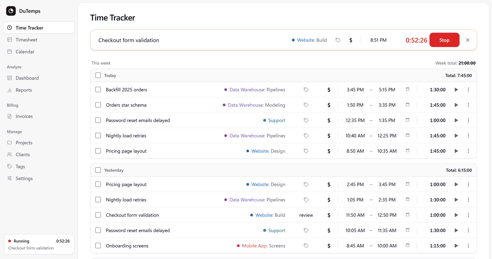
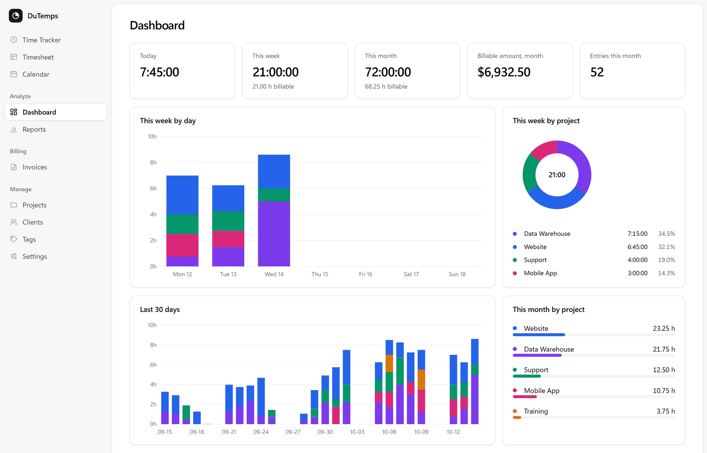
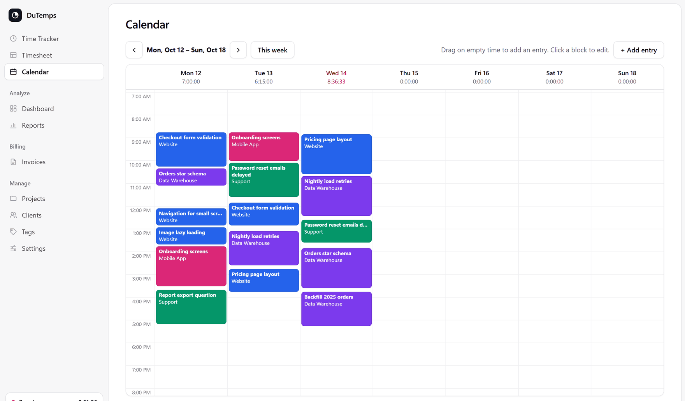
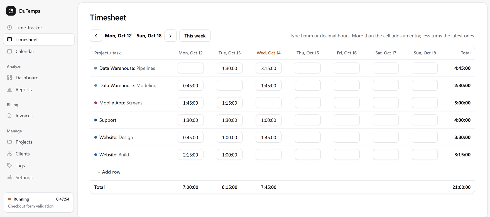
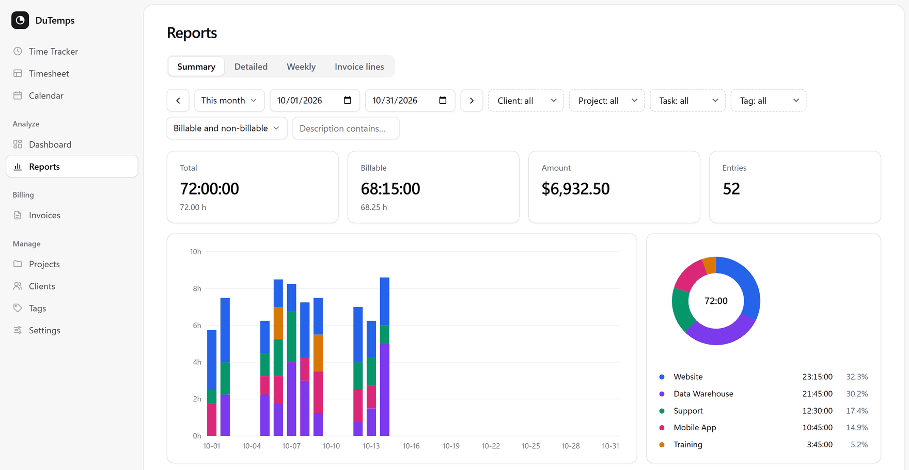
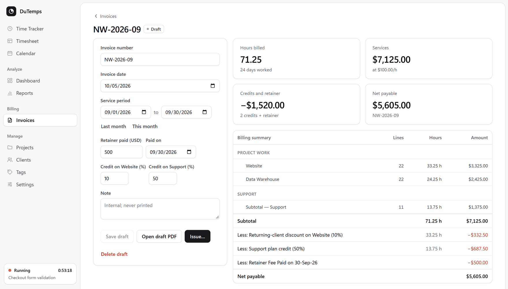
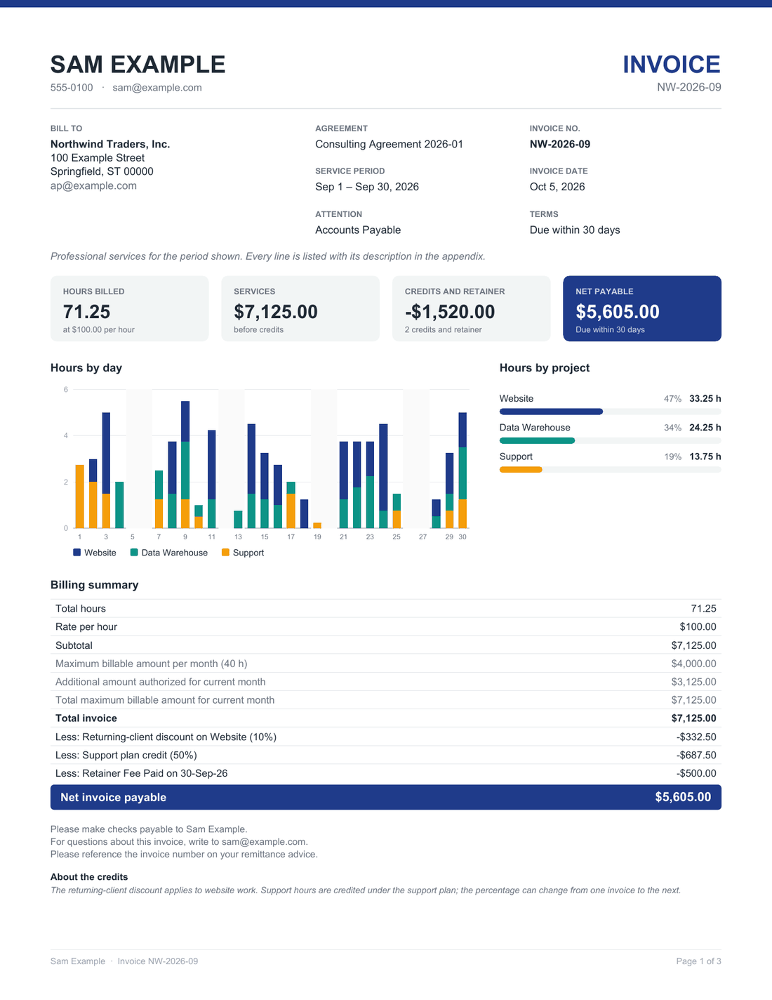
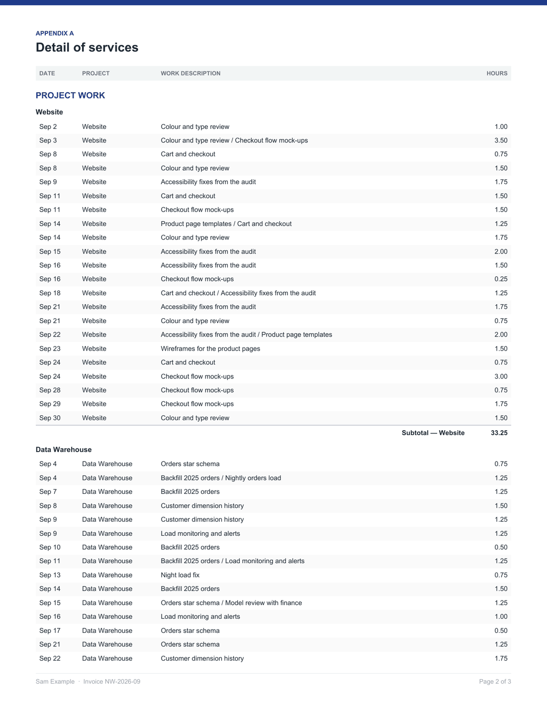

# DuTemps

A local, single-user time tracker with PDF invoices. It covers what a
freelancer or consultant needs from a time tracker: a timer, a timesheet,
reports and exports. It also issues the monthly invoice, and runs entirely on
your own computer.



- **Tracker:** a live timer that survives restarts, manual entries, duplicate,
  continue and bulk delete.
- **Timesheet and Calendar:** a week grid (type hours into a cell to create an
  entry) and a week calendar of entries.
- **Dashboard and Reports:** summary, detailed and weekly reports with filters,
  exported to CSV or Excel.
- **Projects, Clients, Tasks, Tags:** each with colours, billable flags,
  estimates and rates. Rates resolve in this order: entry, task, project,
  client, default.
- **Invoices:** monthly PDF invoices with a summary page, charts, credits and
  discounts, a retainer line, and the full line detail as an appendix. A draft
  recalculates from your entries every time you view it. Once issued, an
  invoice is frozen, and the database refuses to change it.
- **Recovery:** every change goes into an audit log, and a deleted entry can
  be restored from it.

No account, no cloud, and no packages beyond Python's standard library.

The screenshots show made-up demo data.



<table>
  <tr>
    <td width="50%"></td>
    <td width="50%"></td>
  </tr>
  <tr>
    <td align="center">Calendar</td>
    <td align="center">Timesheet</td>
  </tr>
</table>



## Run it

You need Python 3.11 or later.

```
python -m dutemps serve
```

On Windows you can double-click `run.cmd` instead. The app opens at
http://127.0.0.1:8765. Your records are kept in `data/dutemps.db`, which is
created on first run.

On Windows, install the timezone database once. Python's `zoneinfo` needs it
for any timezone other than UTC:

```
pip install -r requirements.txt
```

The Excel export also needs `openpyxl` (`pip install openpyxl`). CSV export
works without it.

## First steps

1. **Settings:** set your timezone, default hourly rate, week start and time
   format. Amounts are shown in US dollars.
2. **Projects / Clients:** add your clients and projects, or import them along
   with your history (below).
3. **Invoices → Invoice settings:** the app ships with an example profile for
   a made-up business. Replace it with your own details: your name and contact,
   the client, rate, sections and credits. Then save. Invoices can't be issued
   until you do. An invoice bills one client, the one chosen there; time filed
   under other clients is left for their own invoices.

## Importing time

From a CSV, one row per entry:

```
python -m dutemps import-csv entries.csv --dry-run
python -m dutemps import-csv entries.csv
```

Columns: `project, client, description, task, user, email, billable,
start_date, start_time, end_date, end_time, duration_hours, billable_rate,
billable_amount`. Times are local, in the timezone set on Settings. An entry
may end the day after it starts. `billable_rate`, when present, is stored on
the entry, so a later change to the project's rate doesn't rewrite past
invoices. The import is idempotent: rows already imported are skipped.
`tests/fixtures/sample_month.csv` is a complete example.

## Invoices

Invoice lines group billable time by local date, project and task. Each
group is rounded to the nearest quarter hour, with a minimum of 0.25 h. That
is why an invoice total can differ slightly from the per-entry amounts in
Reports.

The invoice profile (Invoices → Invoice settings) holds the text that stays
the same from month to month:

- your details and the client's;
- the agreement and payment terms;
- remittance lines;
- **sections**, which list the (project, task) pairs they bill;
- **credits**, a percentage off one project or one section.

Every billable (project, task) must belong to a section. Saving checks that
each string fits where the PDF prints it, and keeps a copy of the old profile
in `data/backups/`.

Each invoice has a number, dates, an optional retainer, and percentages for
this month's credits. Preview the PDF as you go. **Issue** stores the PDF and
a snapshot, and they never change after that. A wrong invoice is voided and
a new one issued.

The monthly maximum and "additional amount authorized" rows come from
`max_hours` in the profile. Set it to 0 to leave them off the invoice.



<table>
  <tr>
    <td width="50%"></td>
    <td width="50%"></td>
  </tr>
  <tr>
    <td align="center">The PDF: summary page</td>
    <td align="center">The PDF: appendix</td>
  </tr>
</table>

## Your data

Everything you enter is in `data/`:

- the database;
- `backups/`;
- `invoice_profile.json`.

The folder is listed in `.gitignore`, so it is never committed. Back it up
like any other folder, or from the command line:

```
python -m dutemps backup                 # data/backups/dutemps-<time>.db
python -m dutemps --db scratch/try.db serve  # try things on a separate database
```

With `--db`, the backups, imports and invoice settings live beside that
database instead, so a scratch run never touches `data/`. `scratch/` is
ignored by git like `data/`.

The server listens on 127.0.0.1 only. It checks the Host header and requires
an `X-DuTemps` header on every write, so a web page open in another tab
can't send it requests.

## Command line

```
python -m dutemps --help
python -m dutemps invoice-lines 2026-09-01 2026-09-30
```

## Use it from Claude Code or Codex (MCP)

DuTemps can run as an [MCP](https://modelcontextprotocol.io) server, so a
coding agent such as Claude Code or Codex can run your timer, log and correct
time, read reports and draft invoices. It is part of DuTemps: standard
library, nothing to install. The agent starts it and talks to it over
stdin/stdout; it opens no port.

```
python -m dutemps mcp                       # normally the agent starts it
python -m dutemps --db scratch/try.db mcp   # on a scratch database
```

The agent starts it from its own folder, so `PYTHONPATH` tells Python where
DuTemps is. In the commands below, replace `C:/path/to/dutemps` with this
folder (forward slashes work on Windows). If `python` isn't the Python you run
DuTemps with (on Windows, the one with `tzdata`), give its full path instead.

Claude Code:

```
claude mcp add dutemps --scope user -e PYTHONPATH=C:/path/to/dutemps -- python -m dutemps mcp
```

Codex, in `~/.codex/config.toml`:

```toml
[mcp_servers.dutemps]
command = "python"
args = ["-m", "dutemps", "mcp"]
env = { PYTHONPATH = "C:/path/to/dutemps" }
```

It uses `data/dutemps.db`, like the app. To give an agent a scratch database
instead, put `--db` and a path before `mcp` (in Codex,
`args = ["-m", "dutemps", "--db", "C:/path/to/scratch.db", "mcp"]`).

The tools:

- reading: `get_status` (today's date, the running timer, totals),
  `get_settings`, `get_dashboard`, `list_projects`, `list_clients`,
  `list_tags`, `list_entries`, `list_deleted_entries`,
  `recent_descriptions`, `report_summary`, `report_weekly`,
  `report_series`, `invoice_lines`, `list_invoices`, `get_invoice`,
  `preview_invoice`, `get_invoice_settings`;
- the timer and entries: `start_timer`, `stop_timer`, `continue_entry`,
  `discard_timer`, `log_time`, `duplicate_entry`, `update_entry`,
  `delete_entries`, `restore_entry`;
- clients, projects, tasks and tags: `create_*`, `update_*` and `delete_*`
  for each (one still in use is archived instead of deleted);
- settings: `update_settings`, `update_invoice_settings` (only the fields
  given change; the old settings are backed up), `preview_invoice_settings`;
- invoices: `create_invoice_draft`, `update_invoice_draft`,
  `delete_invoice_draft`, `issue_invoice`, `void_invoice`,
  `save_invoice_pdf`;
- files: `export_report` (CSV or Excel), `import_csv` (with a dry run),
  `backup_database`. Files go to the path given, or to `exports/` or
  `backups/` beside the database, and never replace an existing file.

Agents name projects, tasks, clients and tags as you do, or by id. A name
that fits more than one, or none, is refused with the candidates listed.
Report filters take one or several of each, as the app's do.
Dates and times are in the time zone on Settings. On the night the clocks go
back, a time in the repeated hour needs its UTC offset (`01:30-05:00`), and a
time in the hour skipped in spring is refused. Every change goes through
the same code as the app, so it is checked the same way and kept in the audit
log, and a deleted entry can be restored (`restore_entry`, or Recently
deleted in the app).

Issuing, voiding and deleting an invoice can't be undone, so those tools
take the invoice number a second time (`confirm`); an agent should use them
only when you ask.

The server can run while the app is open on the same database: SQLite takes
the writes in turn. The app doesn't watch the database, so reload its page to
see what an agent changed.

## Tests

```
python -m unittest discover -s tests -v
```

The tests use the made-up month in `tests/fixtures/` and a temporary copy of
the example invoice profile. They never read or write `data/`.

## Contributing

See [AGENTS.md](AGENTS.md) for the conventions, and [DESIGN.md](DESIGN.md)
for the decisions behind them. Before your first commit, install the leak
check:

```
python scripts/check_private.py --install
```

It refuses commits that include `data/`, databases, `.env` files, PDFs, or
any term you list in `local/private-terms.txt`.

## License

MIT. See [LICENSE](LICENSE).
